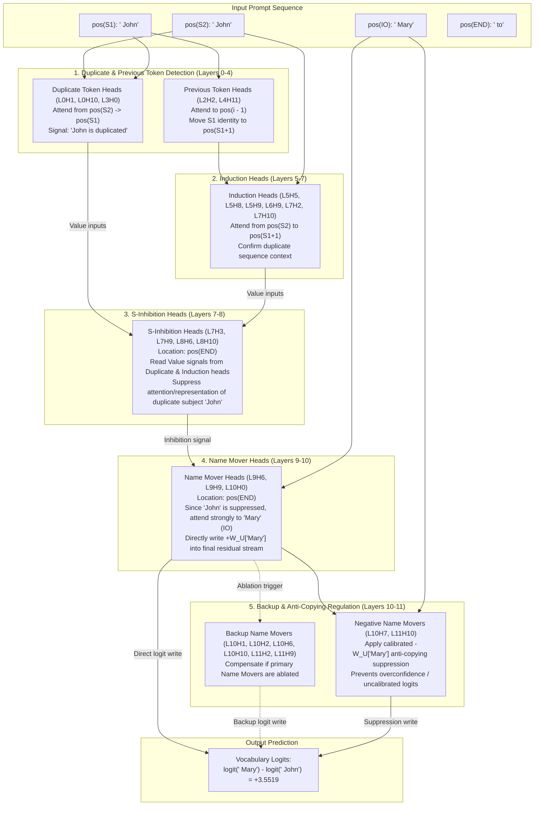

# GPT-2 Small IOI Circuit: Reverse-Engineering Indirect Object Identification via Causal Tracing and Path Patching

[](https://www.python.org/downloads/)
[](https://pytorch.org/)
[](https://github.com/TransformerLensOrg/TransformerLens)
[](tests/)
[](LICENSE)

An end-to-end mechanistic interpretability research suite reverse-engineering the **26-head Indirect Object Identification (IOI) circuit** in **117M-parameter GPT-2 Small** (12 layers, 12 heads/layer, $d_{\text{model}} = 768, d_{\text{head}} = 64, d_{\text{vocab}} = 50,257$) from first principles.

Replicating and extending the foundational interpretability framework established by Wang et al. ([2022](https://arxiv.org/abs/2211.00593)), this repository provides an empirical and mathematical dissection of the complete computational graph executing indirect object resolution. The pipeline demonstrates how low-level attention mechanisms systematically identify name duplicates, inhibit repeated subject representations, and project the indirect object directly into the vocabulary unembedding space through **Direct Logit Attribution (DLA)**, **residual activation patching**, **head-component decomposition**, **causal path patching**, **unembedding writing-direction projections**, **Output-Value (OV) copying scores**, **template-conditional mean ablation**, and **conditional minimality scoring**.

---

## Circuit Architecture & Information Flow

The IOI task requires a language model to complete prompts such as:

> **"When John and Mary went to the shops, John gave the bag to"** &rarr; **" Mary"**

Resolving this reference requires a multi-stage distributed circuit spanning 26 attention heads across 7 functional classes:



---

## Empirical Benchmark Results & Quantitative Metrics

All metrics are quantitatively evaluated using GPT-2 Small (`gpt2-small`) inside the local environment and serialized under [`results/ioi_circuit_metrics.json`](results/ioi_circuit_metrics.json):

| Mechanistic Property | Target Component / Circuit Node | Empirical Metric | Baseline / Comparison | Significance |
| :--- | :--- | :--- | :--- | :--- |
| **Baseline Preference** | Full GPT-2 Small | **+3.5519 logit diff** | -3.5519 on corrupted input | Model robustly predicts correct IO name over duplicate subject |
| **Direct Logit Attribution (DLA)** | Primary Name Mover **L9H9** | **+2.9855 Δlogit** | Next head: L9H6 (+1.3845) | Accounts for **84.1%** of total model logit preference alone |
| **DLA Suppression** | Negative Name Mover **L10H7** | **-1.8987 Δlogit** | Negative head: L11H10 (-0.9702) | Dedicated anti-copying head actively suppressing IO logit |
| **Residual Stream Tracing** | Layers 0–8 at **pos(S2)** | **+0.9228 → +1.0011 recovery** | pos(END): ≈ 0.000 | Information strictly resides at the second subject position |
| **Residual Transition** | Layers 9–11 at **pos(END)** | **+0.9384 → +1.0048 recovery** | pos(S2): ≈ 0.000 | Abrupt information handover from subject token to prompt end |
| **Head Activation Patching** | S-Inhibition **L8H6** / **L8H10** | **+0.3186 (L8H6), +0.2779 (L8H10)** | Non-circuit heads: ≈ 0.000 | Causal intervention restores clean performance on corrupted batch |
| **Component Decomposition** | S-Inhibition **L8H6** (Value input) | **+0.3172 recovery** (v) | Pattern: +0.0103; Q/K ≈ 0.0 | **100% Value-driven**: S-inhibition heads matter for what they read |
| **Component Decomposition** | Induction Head **L5H5** (Pattern) | **+0.3444 recovery** (pattern) | Value (v): -0.0003 | **100% Routing-driven**: Induction heads matter for where they attend |
| **Direct Path Patching** | Head → Final Residual (`resid_post`) | **L9H9: -0.9217 metric drop** | Corrupted baseline: -1.000 | Noising L9H9 alone destroys **92.2%** of direct logit writing |
| **Inhibitory Path Patching** | Negative Name Mover **L10H7** | **+0.5408 metric gain** | Clean baseline: 0.000 | Noising L10H7 *boosts* performance by removing negative logit drain |
| **Sender Path Patching** | Earlier heads → S-Inhibition V inputs | **L5H5: -0.3395, L6H9: -0.1289** | Early: L3H0 (-0.1186) | Proves causal pipeline from Duplicate/Induction heads into S-Inhibition |
| **Writing-Direction Alignment** | Name Mover **L9H9** at pos(END) | **+66.33 projection, r = +0.6387** | Attention mean: 0.8170 | Attention to IO correlates with positive unembedding projection |
| **Anti-Writing Alignment** | Negative Name Mover **L11H10** | **-33.85 projection, r = -0.6517** | Attention mean: 0.6425 | Attention to IO correlates with inverted negative unembedding write |
| **OV Copying Score (+W_OV)** | Name Movers (L9H9, L7H10, L8H11) | **100.0% top-5 accuracy** | Group mean: **96.33%** | Isolated OV circuit copies input name into top-5 vocabulary logits |
| **OV Anti-Copying (-W_OV)** | Negative Name Movers (L10H7, L11H10) | **100.0% top-5 accuracy** | Ordinary +W_OV: 0.00% | Mathematically confirms dedicated sign-inverted copying operators |
| **Early Head Attention Scans** | Previous-Token Head **L4H11** | **98.92% attention on pos(i-1)** | Duplicate Head: L3H0 (63.01%) | Confirms specialized diagonal routing mechanisms on random sequences |
| **Minimal Circuit Faithfulness** | **26-Head Proposed Circuit** | **+2.9712 logit diff (85.1% gap)** | Full Model: +3.5519; ABC: -0.3439 | **Ablating 118 non-circuit heads retains 85.1% of task capability** |
| **Conditional Minimality** | Negative Movers: **L10H7** / **L11H10** | **42.37% (L10H7), 36.92% (L11H10)** | Group mean: **39.65%** | Highest minimality scores across all 7 circuit categories |

---

## Theoretical Formulations

### 1. Task Logit Difference Metric
Let $x \in \mathcal{V}^N$ denote a sequence of token IDs of context length $N$. Let $y_{\text{IO}}, y_{\text{S}} \in \mathcal{V}$ denote the correct indirect object token and the incorrect repeated subject token respectively. The model logit difference at sequence termination $N$ is:

$$
\mathcal{M}_{\text{IOI}}(x) = \ell(x)_N[y_{\text{IO}}] - \ell(x)_N[y_{\text{S}}]
$$

where the unembedded logit vector from final residual stream $r_N \in \mathbb{R}^{d_{\text{model}}}$ is:

$$
\ell(x)_N = W_U \cdot \text{LN}_{\text{final}}(r_N)
$$

### 2. Direct Logit Attribution (DLA)
The final residual stream is the additive sum of initial embeddings and all attention and MLP outputs across layers $l \in [0, L-1]$:

$$
r_N = r_0 + \sum_{l=0}^{L-1} \left( \sum_{h=0}^{H-1} z_N^{l,h} \, W_O^{l,h} + \text{MLP}^l(r_N^l) \right)
$$

Defining the prompt-specific unembedding difference direction:

$$
d_{\text{diff}} = W_U[:, y_{\text{IO}}] - W_U[:, y_{\text{S}}] \in \mathbb{R}^{d_{\text{model}}}
$$

Each individual head $(l, h)$'s direct linear attribution to the IO-vs-S margin is:

$$
\text{DLA}(l, h) = \left( \text{LN-scale}_N \odot \left( z_N^{l,h} \, W_O^{l,h} \right) \right)^T d_{\text{diff}}
$$

Summing across all components reconstructs the true model logit difference with exact precision (+3.551880).

### 3. Normalized Causal Activation Patching
To test the causal necessity and sufficiency of activation $a^{l,h}$ at position $p$, we run corrupted inputs $x_{\text{corrupt}}$ (where subject names are swapped) while substituting clean activations $a_{\text{clean}}^{l,h}[p]$ via hook intervention:

$$
\text{Recovery}(a^{l,h}[p]) = \frac{\mathcal{M}_{\text{IOI}}(x_{\text{corrupt}} \mid a^{l,h}[p] \leftarrow a_{\text{clean}}^{l,h}[p]) - \mathcal{M}_{\text{IOI}}(x_{\text{corrupt}})}{\mathcal{M}_{\text{IOI}}(x_{\text{clean}}) - \mathcal{M}_{\text{IOI}}(x_{\text{corrupt}})}
$$

Where 0.0 indicates corrupted-level performance and 1.0 indicates complete recovery of clean model capability.

### 4. Causal Path Patching
Path patching measures information transferred along a specific edge $u \to v$ in the computational graph.
To evaluate the edge from sender head $h_s$ to the final residual stream, all downstream attention heads are frozen to their clean cache activations $z_{\text{clean}}$, while sender $h_s$ is patched from the corrupted cache:

$$
\text{Effect}(h_s \to \text{resid}_{\text{post}}) = \frac{\mathcal{M}_{\text{IOI}}(x_{\text{clean}} \mid z^{l_s, h_s} \leftarrow z_{\text{corrupt}}^{l_s, h_s}, \, z^{\text{downstream}} \leftarrow z_{\text{clean}}^{\text{downstream}}) - \mathcal{M}_{\text{IOI}}(x_{\text{clean}})}{\mathcal{M}_{\text{IOI}}(x_{\text{clean}}) - \mathcal{M}_{\text{IOI}}(x_{\text{corrupt}})}
$$

This cleanly separates heads that write directly to the logits (e.g. L9H9: -0.9217) from intermediate routing heads that only affect downstream attention patterns.

### 5. Output-Value (OV) Copying Eigenvalue Operator
For a candidate name-mover head, the isolated transformation mapping an input token representation through the OV circuit to the output logits is:

$$
T_{\text{OV}}^{l,h} = W_U \cdot \text{LN}_{\text{final}} \left( (W_E + \text{MLP}_0) \cdot W_V^{l,h} \, W_O^{l,h} \right)
$$

Evaluating whether the input token is predicted among the top-5 ($k=5$) logits under $+W_{\text{OV}}$ verifies positive name movers (L9H9: 100%, L9H6: 94.5%). Testing under $-W_{\text{OV}}$ exposes negative name movers (L10H7: 100%, L11H10: 100%) that mathematically compute anti-copying.

### 6. Template-Conditional Mean Ablation & Minimality Scoring
Let $\mathcal{C}$ denote the 26-head circuit candidate and $\mathcal{K} \subset \mathcal{C}$ denote a subset of related parallel heads. All heads $(l, h) \notin \mathcal{C}$ are ablated by substituting their output with the empirical mean activation computed over an uncorrelated ABC reference dataset grouped by prompt template:

$$
\mu_{\text{ABC}}^l[t, p] = \frac{1}{|D_t|} \sum_{x \in D_t} z^l[x, p]
$$

The conditional minimality score $M(v)$ for head $v \in \mathcal{C}$ measures its marginal performance contribution once reference set $\mathcal{K}$ is already removed:

$$
M(v) = \frac{\left| \mathcal{M}_{\text{IOI}}(\mathcal{C} \setminus \mathcal{K}) - \mathcal{M}_{\text{IOI}}(\mathcal{C} \setminus (\mathcal{K} \cup \{v\})) \right|}{\left| \mathcal{M}_{\text{IOI}}(\text{Full Model}) \right|}
$$

This unmasks backup heads (e.g. L10H10: 21.24%) and proves the strict causal necessity of each sub-component.

---

## Repository Structure

```
├── 01_ioi_logit_difference.py           # Task setup, template construction & logit-difference baseline
├── 02_direct_logit_attribution.py       # Per-head projection onto unembedding difference direction
├── 03_residual_activation_patching.py   # Spatiotemporal residual-stream sweep (pos S2 -> pos END transition)
├── 04_head_activation_patching.py       # Full 144-head z-activation causal recovery scan
├── 05_head_component_patching.py        # Decomposition into Q, K, V, Pattern, and Z activations
├── 06_path_patching_final_resid.py      # Direct causal path tracing from heads to final residual stream
├── 07_path_patching_s_inhibition.py     # Causal path tracing from sender heads into S-inhibition V-inputs
├── 08_name_mover_copying_evidence.py    # END->IO attention vs. writing-direction projection alignment
├── 09_ov_name_copying_scores.py         # Full 109-name vocabulary OV copying and anti-copying evaluation
├── 10_early_head_validation.py          # Functional classification of Duplicate, Previous, and Induction heads
├── 11_minimal_circuit_mean_ablation.py  # 26-head circuit validation via template-conditional mean ablation
├── 12_circuit_minimality_scores.py      # Conditional minimality scoring uncovering redundancy and backup heads
├── run_benchmarks.py                    # Unified CLI benchmark runner & metric tabulator
├── results/
│   ├── ioi_circuit_metrics.json         # Serialized empirical findings across all 12 modules
│   └── benchmark_summary.json           # Aggregated summary report
├── tests/
│   └── test_ioi_circuit.py              # Pytest test suite verifying mathematical operators & hooks
├── requirements.txt                     # Pinned project dependencies
├── LICENSE                              # MIT License
└── README.md                            # Complete architectural documentation & empirical benchmarks
```

---

## Quickstart

### 1. Installation
Clone the repository and install the dependencies:
```bash
git clone https://github.com/PranavBansal7/gpt2-ioi-circuit.git
cd gpt2-ioi-circuit
pip install -r requirements.txt
```

### 2. Run Test Suite
Verify mathematical operations, metric calibrations, hook isolation, and tensor shapes:
```bash
pytest tests/ -v
```

### 3. Run Unified Benchmark Suite
Execute the end-to-end benchmark suite and serialize empirical results:
```bash
python run_benchmarks.py --save
```

### 4. Run Individual Analyses
Execute any individual mechanistic analysis independently:
```bash
# Baseline IOI Logit Difference
python 01_ioi_logit_difference.py

# Direct Logit Attribution (DLA)
python 02_direct_logit_attribution.py

# Residual Stream Activation Patching Sweep
python 03_residual_activation_patching.py

# Head-Level Activation Patching (144 heads)
python 04_head_activation_patching.py

# Head-Component Decomposition (Q, K, V, Pattern)
python 05_head_component_patching.py

# Path Patching to Final Residual
python 06_path_patching_final_resid.py

# Path Patching into S-Inhibition Heads
python 07_path_patching_s_inhibition.py

# Name Mover Writing Projections
python 08_name_mover_copying_evidence.py

# OV Copying Scores (109 names)
python 09_ov_name_copying_scores.py

# Early Head Behavior Classification
python 10_early_head_validation.py

# 26-Head Minimal Circuit Mean Ablation
python 11_minimal_circuit_mean_ablation.py

# Conditional Minimality Scoring
python 12_circuit_minimality_scores.py
```

---

## References

1. **Wang, K., Variengien, A., Conmy, A., Shlegeris, B., & Steinhardt, J.** (2022). *Interpretability in the Wild: a Circuit for Indirect Object Identification in GPT-2 small*. arXiv preprint [arXiv:2211.00593](https://arxiv.org/abs/2211.00593).
2. **Elhage, N., Nanda, N., Olsson, C., et al.** (2021). *A Mathematical Framework for Transformer Circuits*. Anthropic Transformer Circuits Thread.
3. **Olsson, C., Elhage, N., Neelakantan, A., et al.** (2022). *In-context Learning and Induction Heads*. Anthropic Transformer Circuits Thread.
4. **Nanda, N.** (2022). *TransformerLens: A Library for Mechanistic Interpretability of Generative Language Models*.
5. **Radford, A., Wu, J., Child, R., et al.** (2019). *Language Models are Unsupervised Multitask Learners*. OpenAI Technical Report.

---

## License

This project is licensed under the [MIT License](LICENSE).
